# Passione

A modern skin for the [DE1 espresso machine](https://decentespresso.com), powered by [Decaid](https://decentespresso.com/docs) (formerly Streamline-Bridge).

Make Home your own with [live weather](#weather-widget) and [custom JavaScript widgets](#custom-script-widgets). [Install Passione](#installation) directly from Decaid.

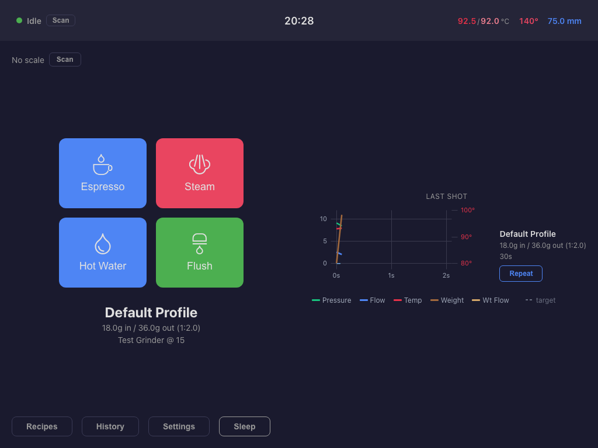

## Features

### Home Screen

The home screen shows real-time machine data and quick-access operation buttons.

- **Status bar** with connection status, clock, mix/group/steam temperatures, water level, and **Scan** button when no device is connected
- **Operation buttons** (Espresso, Steam, Hot Water, Flush) with two-step confirmation to prevent accidental starts
- **Shot plan** showing the active profile, dose, yield, ratio, and grinder setting
- **Recipes** for one-tap switching between saved brewing configurations (profile + coffee + grinder + steam/hot water settings)
- **Last shot** widget with mini graph, metrics, and **Repeat** button to reload the shot's workflow

### Weather Widget

See current conditions, temperature, today's high/low, and humidity alongside your coffee setup.

1. Install and configure the **Weather plugin** (`weather.reaplugin`) in Decaid. See the [official skin and plugin installation guide](https://decentespresso.com/docs/how_to_install_skins_or_plugins_on_decaid).
2. Set your location, units, and refresh preferences in the plugin — Passione uses those settings.
3. In Passione, open **Settings → Display → Home Layout → Edit Layout** and add **Weather** to any zone.

The widget shows a clear message when the plugin is missing, needs a location, or weather data is unavailable.

### Custom Script Widgets

Build your own Home readouts with JavaScript — for example, a custom scale display or a compact coffee-and-ratio card. Scripts receive machine, scale, and workflow snapshots through `passione.state`, with live updates via the `passione-state` event. Theme colours are available as `--passione-*` CSS variables.

1. Open **Settings → Display → Script Widget**.
2. Tap **Reset example** for a working starting point, or paste your own JavaScript.
3. Tap **Test** to preview the draft, then **Apply** to use it on Home. Draft edits autosave without changing the active widget.
4. Open **Home Layout → Edit Layout** and add **Script Widget** to any zone.

Scripts run in an isolated iframe without access to Passione's page or storage, and are not granted Passione/Decaid privileges. **Only use scripts you trust:** networking is still allowed under normal browser rules.

### Recipe Editor

Create and manage complete brewing recipes — profile, beans, grinder, dose, and operation settings — laid out for landscape tablets: a recipe rail on the left, a four-quadrant editor (Coffee, Grinder, Dose + Profile, Operations) on the right.

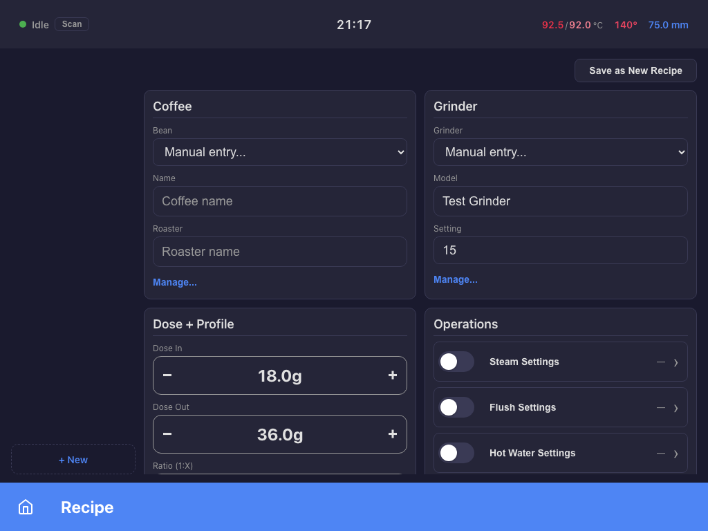

- Set profile, coffee, grinder, dose in/out, and ratio
- Steam, flush, and hot water each toggle on/off from the operations list and open in a focused popup for editing
- Recipes live in a vertical rail — tap to select, tap the pencil (or double-tap) to rename, **+ New** to create one from the current state
- Field edits apply live to the running workflow (300 ms debounce); saved recipes only change when you explicitly tap **Save** or **Save as New Recipe**
- A small dot on the selected recipe marks any divergence between the live workflow and the saved recipe
- From the home screen: tap a recipe to load it, double-tap to open the editor — the Espresso button is the only way to start a shot
- Optional **power-user fields** — Settings → Brewing toggles "Show grinder RPM" and "Show basket data" surface RPM and basket size/type fields in the recipe editor and the shot review page. Per-grinder RPM range (Catalog → Grinders) clamps the RPM input.
- **Connected grinders** — link a catalog grinder to a connected device in Settings → Bridge. Supported grind-setting and RPM controls use the device's capabilities and reported values.

### Profile Management

Browse, search, and manage espresso profiles.

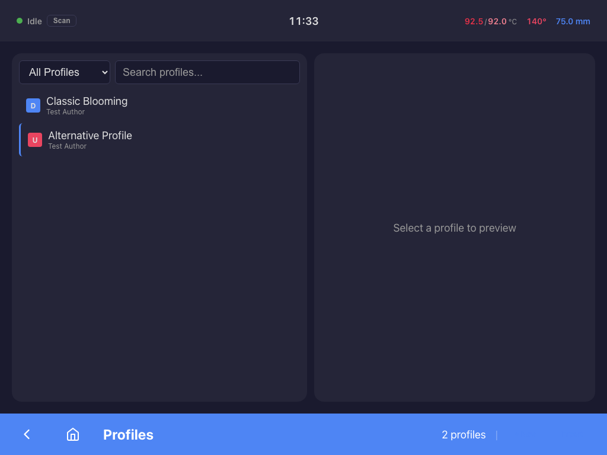

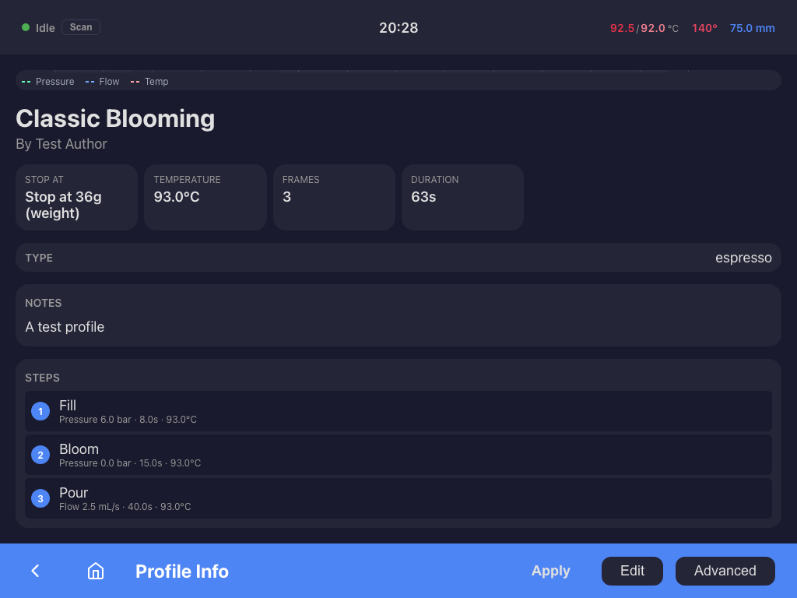

- Search and filter profiles by name or author
- Visual profile graph showing pressure, flow, and temperature curves
- View step-by-step breakdown of each profile frame
- Apply profiles to the current workflow with a single tap
- **Profile Editor** with full frame-by-frame control, matching Streamline-Bridge's native profile schema exactly
- **Quick-start presets** (Classic Espresso, Turbo Shot, Blooming Espresso, Allonge, Lever Style) seed a full frame set in one tap

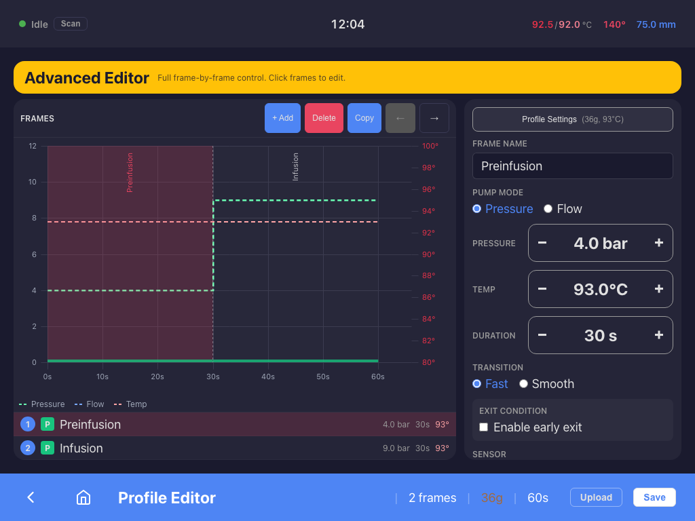

### Shot History

Review past shots with detailed metrics.

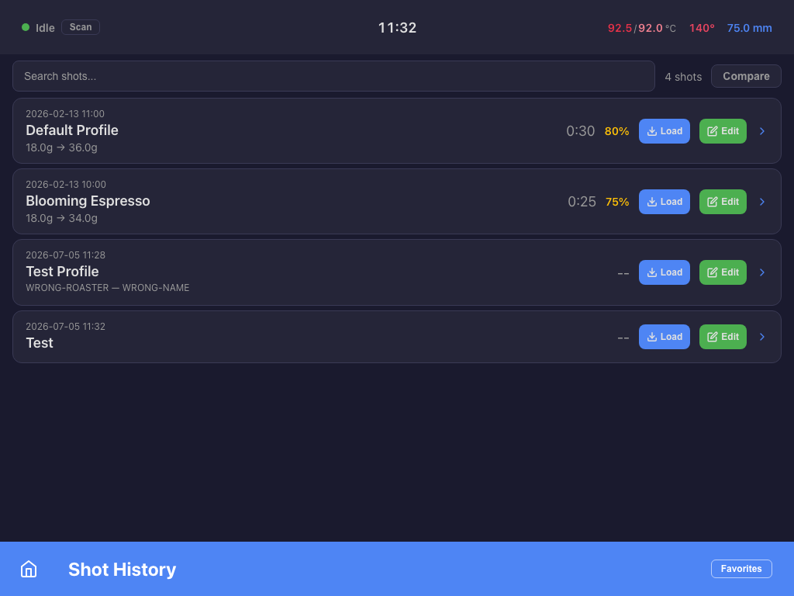

- Paginated list of all shots with profile, dose, duration, and rating
- Search across profile names, coffee, roaster, and grinder
- **Load** button restores the shot's full workflow (profile, coffee, grinder, dose)
- **Edit** button to edit shot notes and rating
- Compare up to 3 shots side-by-side with overlaid graphs
- Import shots from Visualizer

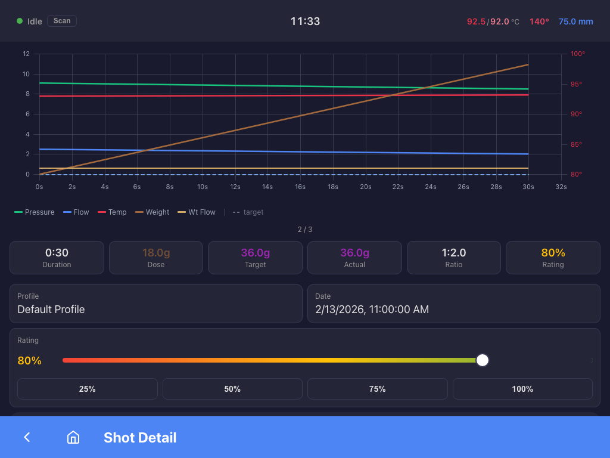

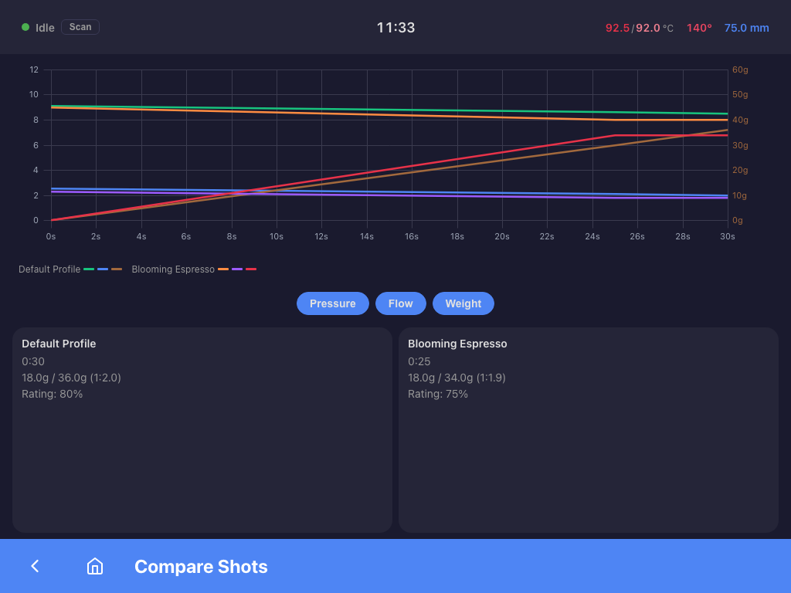

### Layout Customization

Rearrange the home screen to show what matters to you.

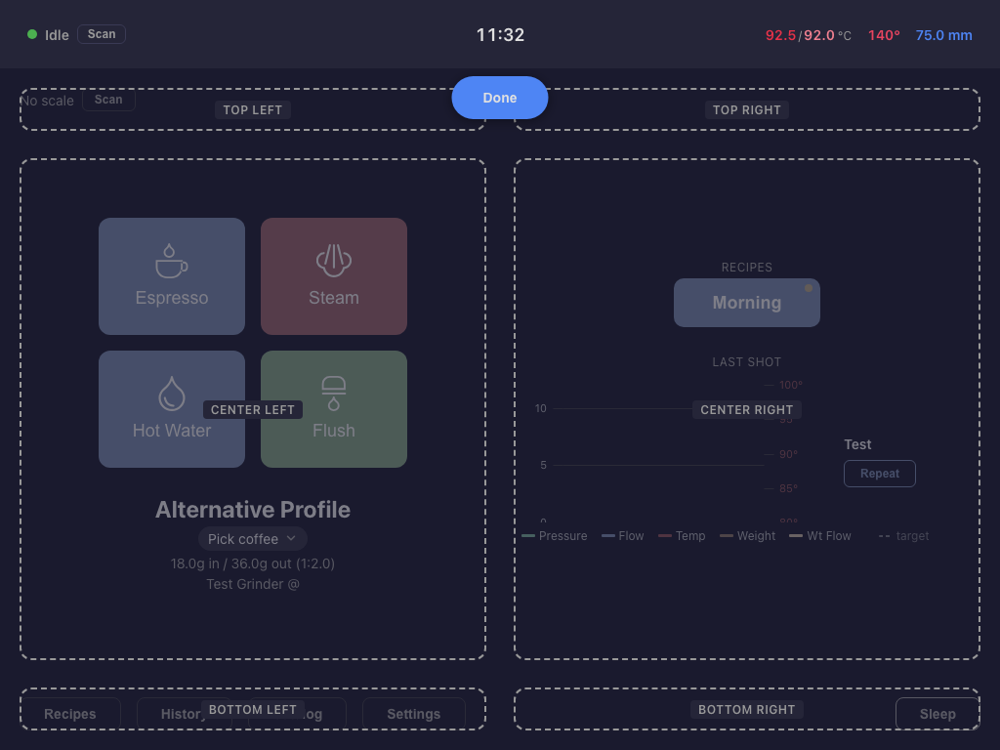
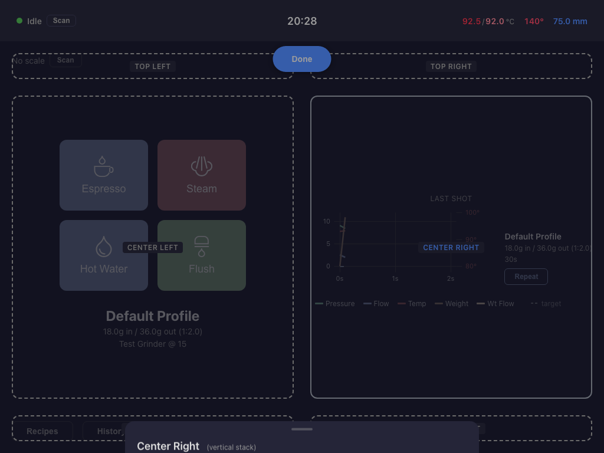

- Enter edit mode from Settings → Display → Home Layout → **Edit Layout**
- Six configurable zones (top, center, bottom -- left and right)
- Drag to reorder, add, or remove widgets from each zone
- Changes apply in real time -- edit directly on the live home screen
- Available widgets include action buttons, shot plan, recipes, combo editor, last shot, navigation, scale info, fullscreen toggle, **Weather**, and **Script Widget**

### Settings

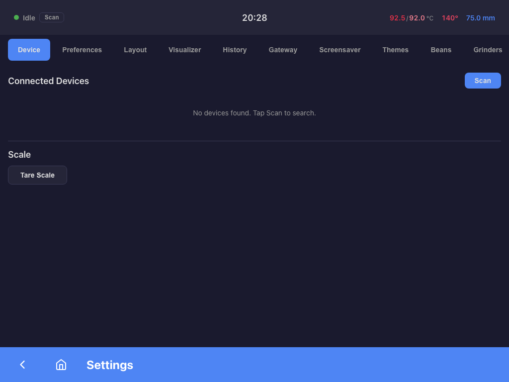

- **Brewing**, **Power**, and **Water**: Brew preferences, sleep schedules, and water-level settings
- **Display**: Home layout, custom script editor, screensaver, and theme colours
- **Bridge**: Device connections, connected grinder linking, and Decaid configuration
- **Visualizer**: Import shots from Decent Visualizer
- **Accessibility** and **About**: Accessibility preferences, app information, updates, and shot-history management

A **Bengle** tab appears when supported machine capabilities are available. Beans and grinders live in **Catalog**, accessible from the home-screen navigation widget.

### Espresso Extraction

- **Phase Timeline** showing real-time extraction progress (Preheat, Pre-infusion, Pouring, Ending) with profile tracking color feedback (green/amber/red)
- **Cup Fill Visualization** -- animated cup graphic tracking yield weight vs target during brewing
- **Real-time shot graphs** with pressure, flow, temperature, and weight curves

### Shot Review

- **Post-shot review** with shot graph, notes, rating, TDS/EY
- **Phase Summary Panel** -- collapsible per-phase metrics table showing duration, avg pressure, avg flow, and weight gained per extraction phase

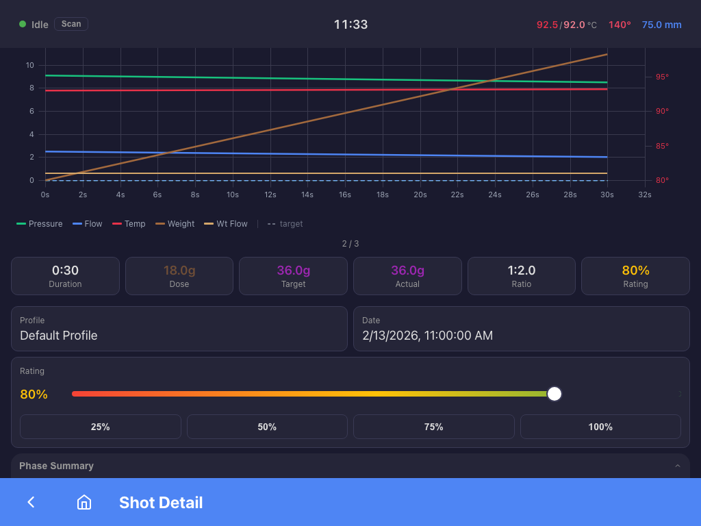

### Auto-Favorites

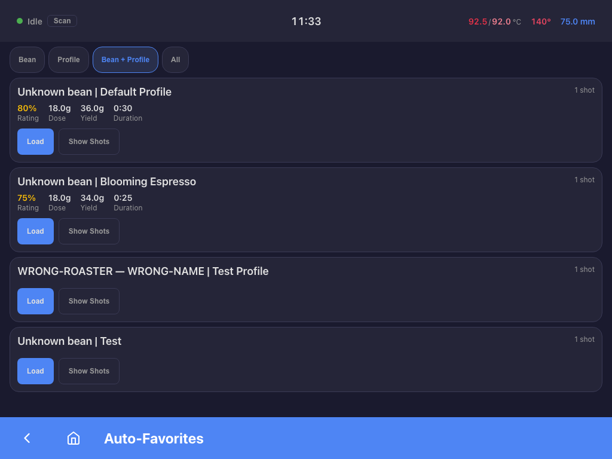

Analyzes your shot history to surface your best-performing bean, profile, and grinder combinations.

**How it works:** The page fetches all your shots, groups them by the criteria you choose, computes average metrics per group, and sorts by rating. This lets you quickly see which setups produce your best espresso and reload them with one tap.

- **Group by**: Bean, Profile, Bean + Profile, or Bean + Profile + Grinder
- **Metrics per group**: average rating, average dose, average yield, average duration, shot count
- **Load**: applies the group's profile, coffee, and grinder settings to your current workflow
- **Show Shots**: navigates to shot history filtered to that combination
- Accessible from the Shot History page via the "Favorites" link in the bottom bar

### Additional Features

- **Descaling wizard** for guided machine maintenance
- **Screensaver** with four modes — Flip Clock, Last Shot recap (dial-in cheat sheet with grinder setting, dose, ratio, and relative age), Ambient Glow, or Disabled. Water-low warning overlays on all non-disabled modes.
- **Ready-in estimate** — when the machine is warming up, the status bar shows a "ready in mm:ss" chip sourced from the Streamline-Bridge `time-to-ready` plugin
- **Power & sleep** schedule management with keep-awake timers
- **Keyboard shortcuts** matching de1app — E/S/W/F for operations, GHC number keys (0=sleep, 1=flush, 2=espresso, 3=steam, 4=hot water), P for sleep, I/Space/Escape to stop, H/R/T for navigation, any key wakes screensaver
- **Responsive design** — mobile-ready layouts across all pages (single-column on phones, split panels on tablets+)
- **Accessibility**: WCAG AAA targets, comprehensive ARIA labels, keyboard navigation, 44px+ touch targets

## Installation

You need **Decaid** running on your tablet or computer. Follow Decent's illustrated guide: **[How to install skins or plugins on Decaid](https://decentespresso.com/docs/how_to_install_skins_or_plugins_on_decaid)**.

### Install the Latest Release (recommended)

1. Open Decaid's **Dashboard**.
2. In the **Skins** section, tap the **cog wheel → Install skin**.
3. Choose **GitHub Release** and enter `tadelv/passione` (not a full URL). Leave the optional asset name blank so Decaid picks the release ZIP automatically.
4. Once installed, launch **Passione** from the Dashboard.

Prefer a ZIP? Download the `passione-v<version>.zip` asset from the [latest release](https://github.com/tadelv/passione/releases/latest), transfer it to your tablet if needed, and choose **ZIP file** in the same installer. Do not use GitHub's source-code ZIP.

### Latest Development Build

In the same installer, choose **GitHub Branch**, enter `tadelv/passione`, and set the branch to **`dist`**. Every push to `main` rebuilds it. This installs **Passione Dev** (`passione-dist`) alongside the release skin without overwriting it.

### Install via REST API (advanced)

Replace `<tablet-ip>` with your Decaid host's address. To install the latest release:

```bash
curl -X POST http://<tablet-ip>:8080/api/v1/webui/skins/install/github-release \
  -H "Content-Type: application/json" \
  -d '{"repo": "tadelv/passione"}'
```

For the development build:

```bash
curl -X POST http://<tablet-ip>:8080/api/v1/webui/skins/install/github-branch \
  -H "Content-Type: application/json" \
  -d '{"repo": "tadelv/passione", "branch": "dist"}'
```

## Development

### Prerequisites

- Node.js 20+
- A Streamline-Bridge instance (or use the mock server for testing)

### Setup

```bash
npm install
```

### Dev Server

```bash
npm run dev
```

The dev server proxies API and WebSocket requests to Streamline-Bridge. Configure the gateway address in `.env.local`:

```
VITE_GATEWAY_URL=http://<tablet-ip>:8080
VITE_WS_URL=ws://<tablet-ip>:8080
```

### Build

```bash
npm run build        # Output in dist/ (release skin: id=passione)
npm run preview      # Preview the production build locally
```

To build a dev skin that installs alongside the release (same as CI):

```bash
VITE_SKIN_ID=passione-dist VITE_APP_VERSION=0.9.3-dev.local npm run build
```

### Test

```bash
npm run test:e2e     # Playwright end-to-end tests (against mock server)
```

## Tech Stack

- **Vue 3** with Composition API and `<script setup>`
- **Vite** for build and dev server
- **vue-router** with hash-based routing
- **vue-i18n** for internationalization
- **uPlot** for real-time shot graphs
- **Playwright** for end-to-end testing

## Contributing

Contributions welcome — see [CONTRIBUTING.md](CONTRIBUTING.md) for setup, conventions, and the PR workflow.

## License

GPL-3.0-or-later — see [LICENSE](LICENSE).
